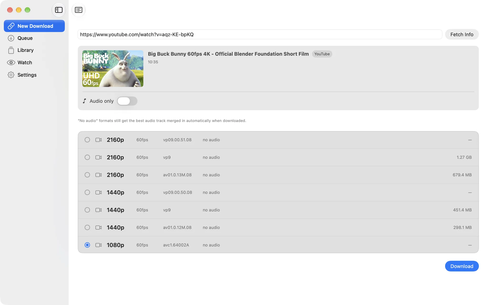
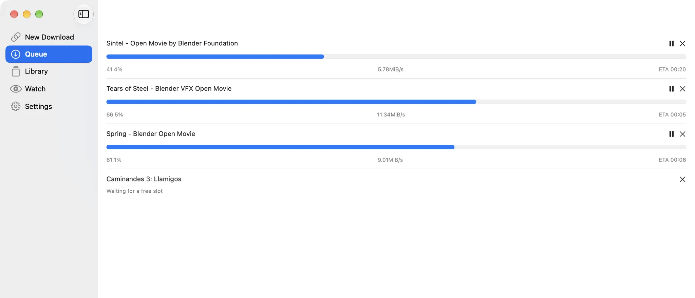

# MediaCatch

A native macOS front end for [yt-dlp](https://github.com/yt-dlp/yt-dlp): paste a link, pick a
format, and let a queue fetch the video, audio or playlist into a library you can search. It can
also watch a channel or playlist and fetch new uploads as they appear.

<picture><source media="(prefers-color-scheme: dark)" srcset="docs/screenshots/fetch-dark.webp"></picture>

MediaCatch is not affiliated with Replay Media Catcher or any other product with a similar name.

## What it does

- **Formats**: every format yt-dlp reports, with resolution, frame rate, codec and size, or
  audio only. A video-only format gets the best audio track merged in.
- **Queue**: several downloads at once (the limit is a setting), with progress, speed and time
  left, pause, resume and cancel. Optional rate limit and subtitles.
- **Batch and playlists**: paste links one per line, or a playlist link that expands into its
  videos for review, before everything goes to the queue.
- **Library**: completed downloads with Play and Reveal in Finder, failed ones with Retry, and
  every link you have fetched, searchable and ready to fetch again.
- **Watch**: a channel or playlist is checked on a schedule and new uploads are downloaded
  automatically.
- yt-dlp updates itself in the background, independently of the app's own releases.
- Notifications, a menu bar count of active downloads, light and dark appearance, English and
  Vietnamese.

<picture><source media="(prefers-color-scheme: dark)" srcset="docs/screenshots/queue-dark.webp"></picture>

## Use it responsibly

MediaCatch downloads only what yt-dlp can fetch from a public URL. It does not break DRM or
any other copy protection. Download only content you own, content that is licensed for
download, or content you have permission to save, and follow the terms of the site you use.
The screenshots show films from the [Blender Foundation](https://studio.blender.org/films/),
released under Creative Commons.

## Requirements

macOS 14 or later.

## Install

Download the latest version from
[apps.dangkhoabach.vn/dkb-downloader](https://apps.dangkhoabach.vn/dkb-downloader).

The app is not signed with an Apple Developer ID, so macOS blocks the first launch. Open it
once from **System Settings → Privacy & Security → Open Anyway**. Updates then arrive through
**Check for Updates…** ([Sparkle](https://sparkle-project.org/), signed with EdDSA).

MediaCatch was called DKB Downloader up to version 2.1.1. It is the same app with the same
bundle identifier, so an installed copy keeps its library, settings and updates.

## How it works

- **`MediaCatchCore`** (Swift package: Foundation and GRDB): the download engine that runs
  yt-dlp and ffmpeg as child processes and parses their progress, the queue, the library and
  the channel watcher, SQLite storage. It is tested headless.
- **`MediaCatchApp`** (SwiftUI and AppKit): the windows, the menu bar, notifications and
  Sparkle.
- yt-dlp and ffmpeg are bundled in `Contents/Resources/bin`. See
  [THIRD-PARTY-NOTICES.md](THIRD-PARTY-NOTICES.md) for their licenses: yt-dlp is public domain
  (Unlicense), the bundled ffmpeg build is GPL v3 and the notice carries the offer of its
  source.

The first version was built with Tauri and React; it was rewritten in Swift in 2026 and reads
the same database, so the upgrade kept the whole library.

## Build from source

Requirements: Xcode 26 or later.

```zsh
./scripts/fetch-sidecars.sh   # once: downloads yt-dlp and a pinned ffmpeg, checked by SHA-256
open MediaCatch.xcodeproj
```

The app target uses automatic signing with no team, so a local build is ad-hoc signed. Run the
`MediaCatchApp` scheme.

Tests:

```zsh
cd MediaCatchCore && swift test   # 92 tests; the integration tests run the real yt-dlp and need network
```

Releases are built, signed and published by hand: see [docs/release.md](docs/release.md).

## Forking

Change these before you ship your own build, so it neither replaces itself with the official
release nor shares its data:

- `PRODUCT_BUNDLE_IDENTIFIER` in the Xcode project.
- `SUFeedURL` and `SUPublicEDKey` in `MediaCatchApp/Info.plist` (generate your own key with
  Sparkle's `generate_keys`).

## Contributing

Issues are welcome. This is a personal project, so pull requests are read but may not be
merged.

## License

[MIT](LICENSE) for the source code. The bundled yt-dlp and ffmpeg keep their own licenses
(see [THIRD-PARTY-NOTICES.md](THIRD-PARTY-NOTICES.md)). The MediaCatch name, app icon and logo
are not covered by the license; use your own for a fork.
